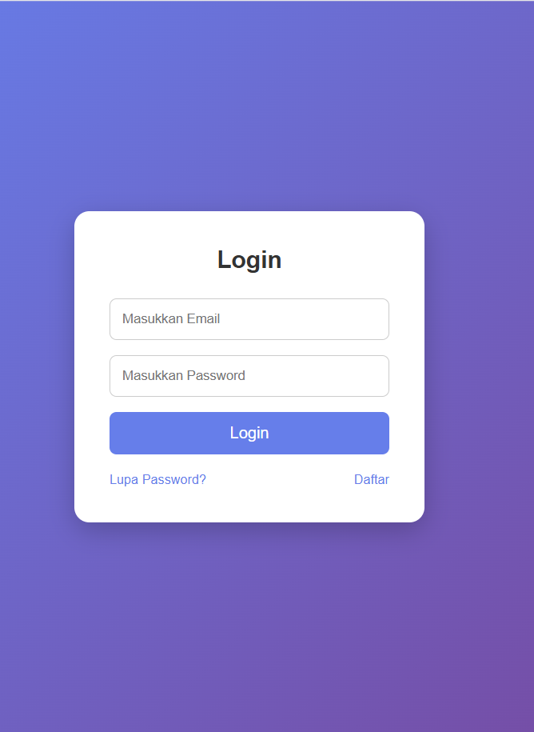
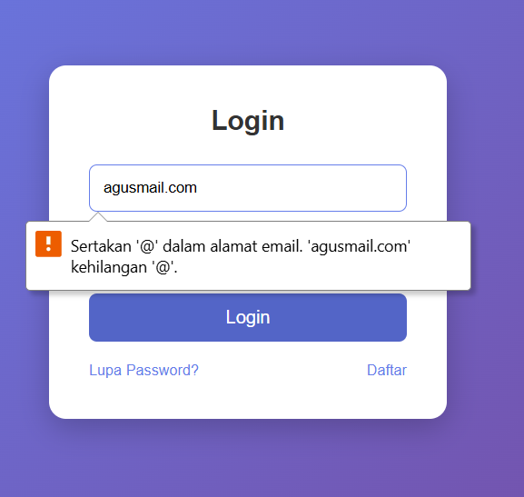
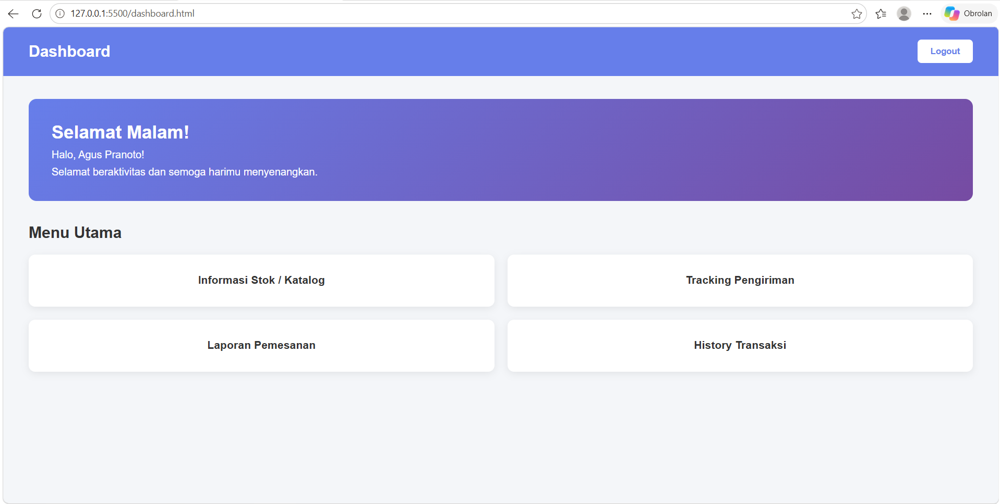
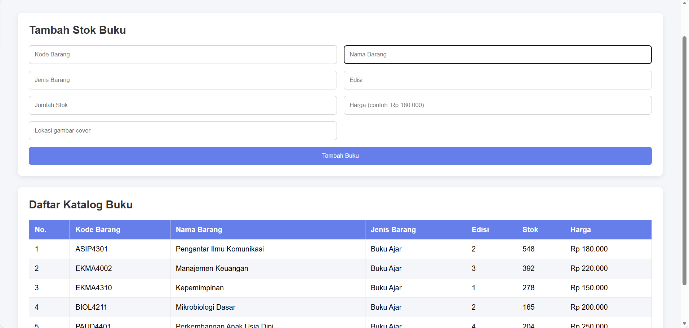
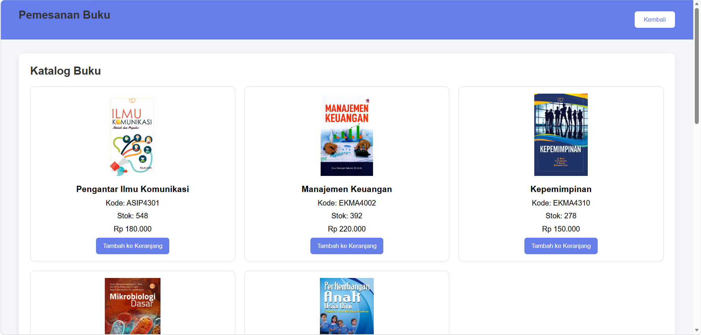
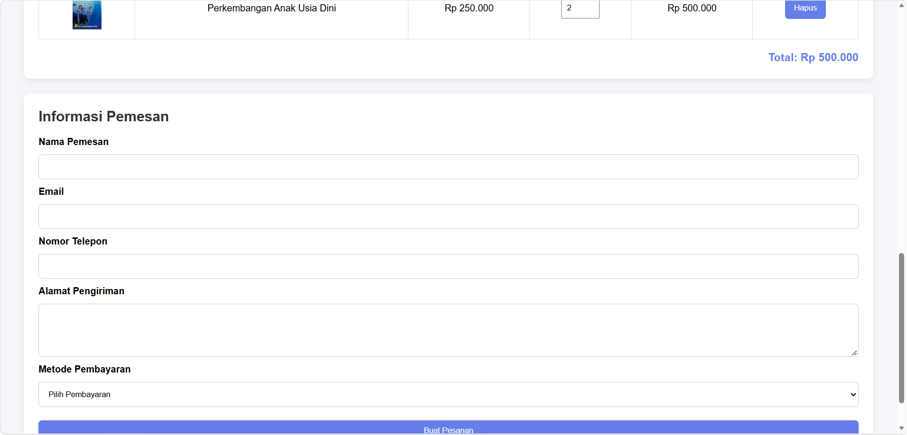
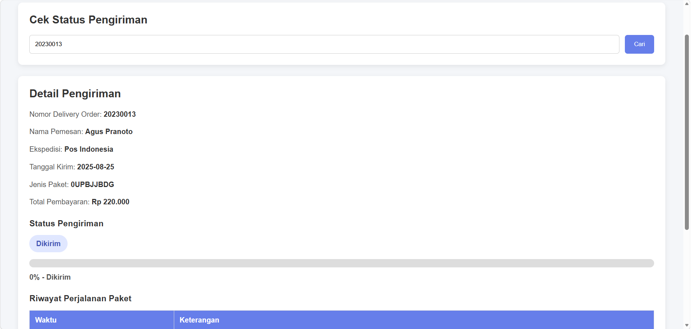
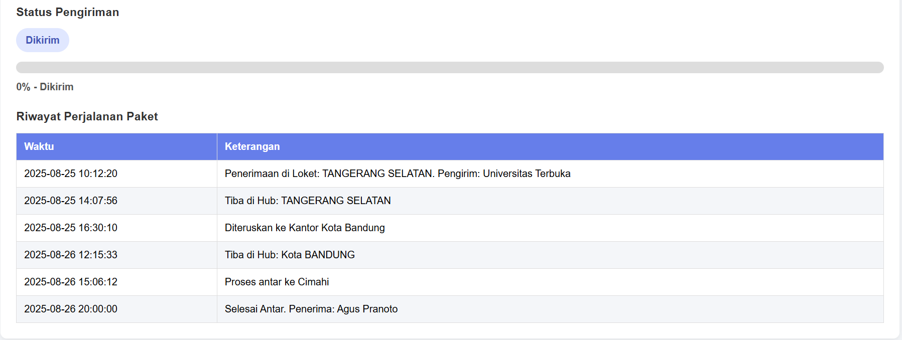
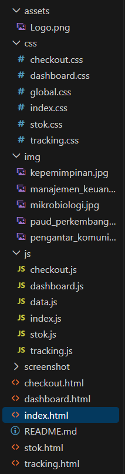

# Tugas UTS Pemrograman Berbasis Web 1
## Aplikasi Pustaka & Toko Bahan Ajar Digital

### Halaman Login

1. Input email dan password
2. Tombol login
3. Fitur pengecekan email dan password
4. Fitur Lupa Password Dan Daftar akun baru

## Result

### Halaman Dashboard

1. Menampilkan informasi stok/katalok
2. Tracing Pengiriman
3. Laporan Pemesanan
4. History Transaksi

## Result

### Halaman cekout

1. Menampilkan semua data buku yang berada di data.js
2. Fitur untuk menambahkan stok buku baru dengan DOM

## Result

### Membuat halaman Checkout

1. Menampilkan data pemesan
2. Menampilkan informasi data buku dan pemesan serta total harga pesanan

### Tracking Pesanan

1. Menampilkan semua informasi pesanan buku dan riwayat perjalanan paket buku

## Result

